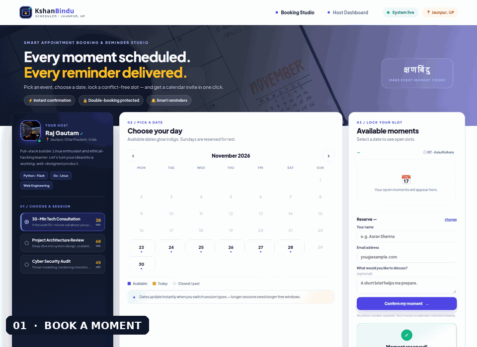
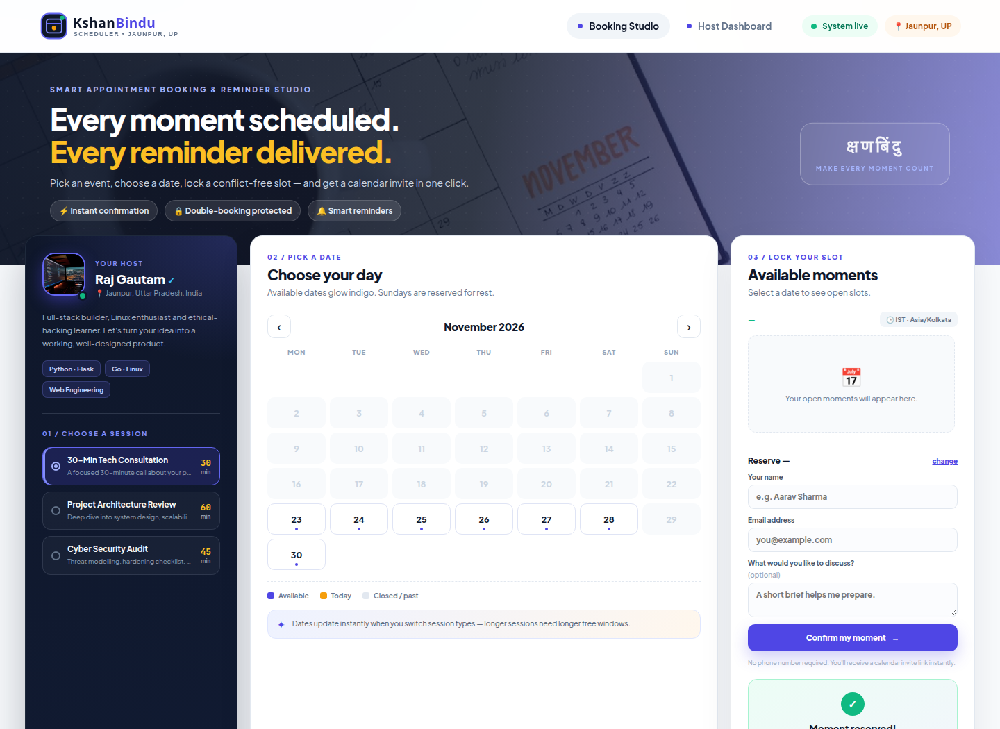
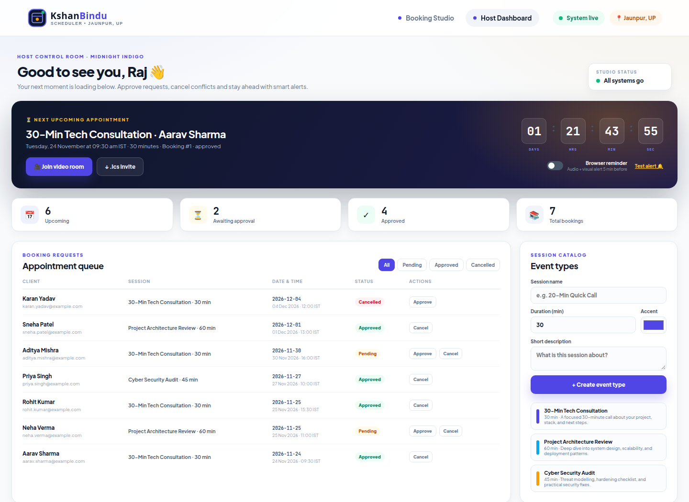
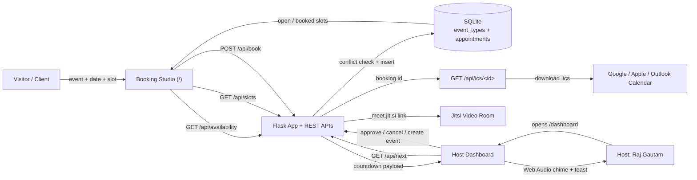

<div align="center">


<br/>


<br/>


<br/>

<a href="https://readme-typing-svg.demolab.com">
  
</a>

<br/>


**Smart Appointment Booking & Reminder Studio** · engineered by **Raj Gautam** · Jaunpur, Uttar Pradesh, India

*क्षणबिंदु — हर पल सूचीबद्ध, हर रिमाइंडर डिलीवर।*

</div>

---

## ✨ What is KshanBindu?

**KshanBindu** (क्षणबिंदु = "the precise point of a moment") is a full-stack appointment booking platform with a distinctive **Crisp Porcelain Daylight & Midnight Indigo 3-Pane Scheduler**. It replaces scattered DMs and double-booking chaos with one calm, fast workflow:

1. Pick a session type — *30-Min Tech Consultation*, *Project Architecture Review*, or *Cyber Security Audit*.
2. Pick a date on the custom vanilla-JS monthly calendar.
3. Lock an open slot — booked times are automatically disabled from SQLite.
4. Download a `.ics` invite that opens directly in Google Calendar, Apple Calendar or Outlook.
5. Host approves/cancels from a live dashboard with a countdown and browser reminder alerts.

> 🔒 **Zero phone numbers.** No phone field, no phone storage, no phone display — only email and a Jitsi meeting link.

---

## 🎬 Live Demo Preview

<div align="center">



</div>

---

## 🖼️ Real UI Screenshots

| Booking Studio — `/` | Host Dashboard — `/dashboard` |
| :---: | :---: |
|  |  |
| Host + event card, monthly calendar, conflict-free slot picker, `.ics` download | Live countdown, audio/visual reminder toggle, approvals, event-type manager |

---

## 🧩 The 3-Pane Experience

| Pane | What it does |
| :--- | :--- |
| **🌙 Midnight Indigo Host Panel** | Host profile (Raj Gautam · Jaunpur, UP), event-type selector, duration badge, auto-generated Jitsi video-room badge. |
| **⚪ Porcelain Calendar** | Custom monthly grid with `‹ Prev` / `Next ›`, availability dots, Sunday closure, today marker — pure Vanilla JS, no date library. |
| **⚡ Smart Slot Studio** | Live open slots, **🔒 Booked** locks against double-booking, booking modal, one-click `.ics` invite, Jitsi link and confirmation. |

### Feature highlights

- **Conflict-free booking** — overlapping slots are blocked in a single SQLite write transaction (`BEGIN IMMEDIATE`).
- **Dynamic availability** — changing the event type recomputes open dates because longer sessions need longer free windows.
- **Real calendar invites** — RFC 5545 `.ics` with `VALARM` (30-minute before trigger) and Asia/Kolkata → UTC conversion.
- **Smart reminders** — live day/hour/min/sec countdown plus Web Audio chime + visual toast 5 minutes before the next appointment.
- **Host controls** — approve, cancel, filter bookings and create new event types from the dashboard.
- **Responsive** — 3 panes → 2 → 1 as the viewport narrows.
- **No external runtime dependencies** beyond Flask — no Node build step, no CDN JS.

---

## 🗺️ Data Flow Diagram



---

## 🚀 Quick Start

> GitHub adds a **copy button** to every block below — pick your OS and paste.

### 🐧 Linux (Pop!_OS / Ubuntu / Debian)

```bash
sudo apt update && sudo apt install -y python3 python3-pip python3-venv git
git clone https://github.com/Rg100152/kshanbindu.git
cd kshanbindu
python3 -m venv .venv
source .venv/bin/activate
pip install -r requirements.txt
python3 seed_appointments.py
python3 app.py
```

### 🍎 macOS (Terminal / Zsh)

```bash
xcode-select --install 2>/dev/null || true   # only if python3 is missing
git clone https://github.com/Rg100152/kshanbindu.git
cd kshanbindu
python3 -m venv .venv
source .venv/bin/activate
pip install -r requirements.txt
python3 seed_appointments.py
python3 app.py
```

*Homebrew alternative:* `brew install python git` before the steps above.

### 🪟 Windows — PowerShell

```powershell
git clone https://github.com/Rg100152/kshanbindu.git
cd kshanbindu
py -m venv .venv
.\.venv\Scripts\Activate.ps1
pip install -r requirements.txt
python seed_appointments.py
python app.py
```

If PowerShell blocks activation, allow it for this session only:

```powershell
Set-ExecutionPolicy -Scope Process -ExecutionPolicy Bypass
```

### 🪟 Windows — Command Prompt (cmd)

```bat
git clone https://github.com/Rg100152/kshanbindu.git
cd kshanbindu
py -m venv .venv
.\.venv\Scripts\activate.bat
pip install -r requirements.txt
python seed_appointments.py
python app.py
```

Then open:

| Page | URL |
| :--- | :--- |
| Booking Studio | <http://127.0.0.1:5000/> |
| Host Dashboard | <http://127.0.0.1:5000/dashboard> |
| Health check | <http://127.0.0.1:5000/health> |

> If port 5000 is busy, change the last line of `app.py` to `app.run(host="127.0.0.1", port=5001, debug=False)` and open `http://127.0.0.1:5001/`.

---

## 📁 Project Structure

```text
kshanbindu/
├── app.py                          # Flask routes, SQLite logic, .ics generator
├── seed_appointments.py            # Idempotent sample event types + appointments
├── requirements.txt                # Flask only
├── templates/
│   ├── base.html                   # Shared shell, nav and developer credits
│   ├── index.html                  # 3-pane booking studio
│   └── dashboard.html              # Host control room + countdown
├── static/
│   ├── css/kshanbindu.css          # Porcelain / Midnight Indigo design system
│   ├── js/scheduler.js             # Calendar, slots, modal, reminders, AJAX
│   └── assets/
│       ├── logo-kshanbindu.svg     # Custom calendar + moment dot + bell spark logo
│       ├── banner.jpg              # Hero banner
│       ├── avatar.jpg              # Host avatar
│       ├── screenshot-booking.png  # Real screenshot of /
│       ├── screenshot-dashboard.png# Real screenshot of /dashboard
│       └── demo-preview.gif        # Animated README preview
├── tools/make_demo_gif.py          # Regenerate the demo GIF from screenshots
├── .gitignore
└── README.md
```

---

## 🔌 API Reference

| Method | Endpoint | Purpose |
| :--- | :--- | :--- |
| `GET` | `/` | 3-pane booking studio |
| `GET` | `/dashboard` | Host dashboard |
| `GET` | `/api/event-types` | List event types |
| `POST` | `/api/event-types` | Create a custom event type |
| `GET` | `/api/availability?year=&month=&event_type_id=` | Dates with at least one open slot |
| `GET` | `/api/slots?date=YYYY-MM-DD&event_type_id=` | Slots with `available` / `booked` / `unavailable` status |
| `POST` | `/api/book` | Reserve a slot (conflict-checked transaction) |
| `GET` | `/api/bookings` | All bookings for the host queue |
| `POST` | `/api/bookings/<id>/approve` | Approve a request |
| `POST` | `/api/bookings/<id>/cancel` | Cancel a request |
| `GET` | `/api/next` | Next upcoming appointment + ISO start time |
| `GET` | `/api/ics/<id>` | Download the `.ics` calendar invite |
| `GET` | `/health` | JSON health probe |

Example booking payload:

```json
{
  "event_type_id": 1,
  "client_name": "Aarav Sharma",
  "client_email": "aarav@example.com",
  "notes": "Portfolio review and Flask deployment.",
  "date": "2026-11-24",
  "time": "09:30"
}
```

---

## 🧪 Regenerating Visual Assets

```bash
# 1. Start the app (in one terminal)
python3 seed_appointments.py && python3 app.py

# 2. Capture fresh headless screenshots (in another terminal)
google-chrome --headless=new --no-sandbox --disable-gpu --hide-scrollbars \
  --window-size=1440,1050 --virtual-time-budget=5000 \
  --screenshot=static/assets/screenshot-booking.png http://127.0.0.1:5000/
google-chrome --headless=new --no-sandbox --disable-gpu --hide-scrollbars \
  --window-size=1440,1050 --virtual-time-budget=5000 \
  --screenshot=static/assets/screenshot-dashboard.png http://127.0.0.1:5000/dashboard

# 3. Rebuild the animated GIF
pip install pillow
python3 tools/make_demo_gif.py
```

---

## 👨‍💻 Developer Profile Card

<table>
  <tr>
    <td align="center" width="180">
      <br/>
      <strong>Raj Gautam</strong><br/>
      <sub>Full-Stack Builder · Linux Enthusiast<br/>Ethical Hacking Learner</sub>
    </td>
    <td>
      <h3>क्षणबिंदु • KshanBindu</h3>
      <p>Building fast, lightweight and visually striking software from <strong>Jaunpur, Uttar Pradesh, India</strong>. Focus: Python, Flask, Go, CLI utilities and calm web engineering.</p>
      <p>
        <a href="mailto:graj13099@gmail.com">📧 graj13099@gmail.com</a><br/>
        <a href="https://instagram.com/linux.userraj" target="_blank" rel="noopener">📸 @linux.userraj</a><br/>
        <a href="https://github.com/Rg100152" target="_blank" rel="noopener">🐙 github.com/Rg100152</a>
      </p>
      <p><em>“Every Moment Scheduled, Every Reminder Delivered.”</em></p>
    </td>
  </tr>
</table>

---

<div align="center">


<sub>Made with ♥ by Raj Gautam · No phone numbers, ever.</sub>

</div>
